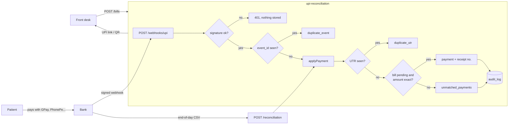

# upi-reconciliation

[](https://github.com/YOUR_GITHUB_USERNAME/upi-reconciliation/actions/workflows/ci.yml)

A small backend that records UPI payments for a clinic front desk and proves every rupee is accounted for.

Small private hospitals in India take most outpatient payments over UPI. In practice the receptionist marks a bill "paid" because the patient shows a phone screen. Screenshots can be faked, receipts can skip numbers, and the bank's webhooks arrive twice, late, out of order, or not at all. This service doesn't take anyone's word for it. A bill is paid only when the bank says so with a signed webhook. Every payment gets a gapless receipt number. Every money event goes into an audit log the database won't let anyone edit. At the end of the day everything is checked against the bank's settlement file.

There's no real bank behind it, so the project comes with a **bank simulator** that pays bills and misbehaves on purpose.

> This is an open-source reimplementation of the payment approach I used in Medara HMIS, running against a simulated bank. It is not Medara's code and it does not connect to a real bank.

## The simulator

```
$ npm run simulate -- 200 --seed=42

What the bank did
  bills created           200
  webhooks sent           306
  duplicates sent later   31
  same-instant bursts     12
  same UTR, new event id  7
  webhooks dropped        9
  wrong amounts           8
  bills paid twice        4
  unknown references      3
  pending events          6
  failed payments         6
  forged webhooks         1

What the service answered
  amount_mismatch         7
  double_payment          4
  duplicate_event         94
  duplicate_utr           7
  ignored                 12
  matched                 178
  unknown_reference       3

Reconciliation for 2026-10-16 (201 bank lines, saved to sim-output/settlement-2026-10-16.csv)
  matched                 178
  recovered               9
  amount_mismatch         0
  unmatched_known         14
  not_in_settlement       0

Checks
  PASS  every bank line accounted for        201 of 201
  PASS  nothing missing from the bank file   0 not_in_settlement
  PASS  bills paid as expected               186 paid, expected 186
  PASS  receipts gapless from 1              1..186 (186 receipts)
  PASS  forged webhook rejected              HTTP 401
  PASS  no webhook errors                    0 non-200 replies

Every rupee is accounted for.
```

The 9 dropped webhooks never reached the service, but the money still showed up in the bank's file, so reconciliation recovered them and gave them the next receipt numbers. The 14 `unmatched_known` lines are the wrong amounts, double payments and unknown references. Those are already in the queue for a human to look at.

You can turn the chaos up: `npm run simulate -- 200 --burst=0.3 --drop=0.2 --doublePay=0.1`.

## How it works



The important parts, and where to find them:

- **Two duplicate guards.** The bank can resend a webhook (same `event_id`), or send the same money under a new event (same `UTR`). The first is stopped by a unique index on `webhook_events.provider_event_id`. When ten copies arrive at once, nine of them wait on that index and then do nothing. The second is stopped by a transaction-scoped advisory lock on the UTR plus unique constraints. See [src/webhook.ts](src/webhook.ts) and [src/applyPayment.ts](src/applyPayment.ts).
- **Gapless receipts.** Numbers run 1, 2, 3... per Indian financial year (April to March, in IST). The counter is a single row per year, bumped with an upsert inside the payment transaction. The row lock makes concurrent payments take turns, and a rollback undoes the bump, so a failed payment never burns a number. See [src/receipts.ts](src/receipts.ts).
- **Append-only audit log.** A trigger raises an error on any `UPDATE` or `DELETE` on `audit_log`. That rule lives in the database, so it holds whatever the app code does. See [db/schema.sql](db/schema.sql).
- **One transaction per webhook.** If anything fails halfway, everything rolls back and the handler returns 500, so the bank's retry starts from scratch.
- **Reconciliation both ways.** Each line in the bank file is `matched`, `recovered` (we never got the webhook), `amount_mismatch` or `unmatched_known`. Each payment we recorded for that day that is missing from the file is `not_in_settlement`. See [src/reconcile.ts](src/reconcile.ts).
- **Money is always integer paise** (`bigint`). There's no floating-point money anywhere, not even when building the UPI link.

## Running it

You need Node 22+ and Docker.

```bash
git clone https://github.com/YOUR_GITHUB_USERNAME/upi-reconciliation.git
cd upi-reconciliation
npm install
cp .env.example .env          # then set WEBHOOK_SECRET to any random string
docker compose up -d          # Postgres 16, with a separate upi_test database
npm run db:reset              # loads db/schema.sql
npm test
npm run simulate -- 200
npm start                     # http://localhost:3000
```

`npm run simulate` and `npm run db:reset` wipe the `upi` database. The tests use `upi_test` and wipe it before every test.

## API

| Method and path | Body | Returns |
| --- | --- | --- |
| `POST /bills` | `{ "patient_name": "Ravi Kumar", "amount_paise": 50000 }` | `201` with `id`, `reference`, `amount_paise`, `status`, `upi_link` |
| `GET /bills/:reference` | | The bill, plus `utr`, `receipt_fy` and `receipt_no` once paid. `404` if unknown |
| `GET /bills/:reference/qr.svg` | | QR code of the UPI link, for the patient to scan |
| `POST /webhooks/upi` | Raw JSON from the bank, signed in `X-Bank-Signature` | `200 { result }`, `401` bad signature, `400` bad JSON, `500` retry later |
| `POST /reconciliation?date=YYYY-MM-DD` | `text/csv`: `utr,amount_paise,reference,paid_at` | `runId` and counts per status |
| `GET /unmatched` | | Payments waiting for a human, with the reason |

A webhook from the (simulated) bank looks like this. The signature is a hex HMAC-SHA256 of the raw body, made with `WEBHOOK_SECRET`:

```json
{
  "event_id": "evt_3f9a1c2b7d4e5a60",
  "type": "payment.success",
  "utr": "426512345678",
  "amount_paise": 50000,
  "reference": "BILL-7CAB523BEB",
  "payer_vpa": "ravi@okaxis",
  "paid_at": "2026-10-16T10:15:00+05:30"
}
```

`result` is one of `matched`, `duplicate_event`, `duplicate_utr`, `amount_mismatch`, `double_payment`, `unknown_reference` or `ignored` (for `payment.pending` and `payment.failed`).

## Tests

Everything runs with Vitest against a real PostgreSQL database, with no mocks. CI runs it on every push with a Postgres 16 service container.

| Test | Proves |
| --- | --- |
| Same webhook twice gives one payment and one receipt | event dedup |
| 10 identical webhooks at once give one payment | event dedup under concurrency |
| Same UTR under two event ids, at once, gives one payment | UTR dedup |
| 50 different payments at once get receipts exactly 1 to 50 | gapless receipts |
| Bad, missing or tampered signature gives 401 and stores nothing | webhook auth |
| Wrong amount leaves the bill pending and adds a row to unmatched | matching |
| A dropped webhook is recovered by reconciliation with the next receipt number | reconciliation |
| `UPDATE`/`DELETE` on audit_log is refused | append-only audit |
| A payment at 00:30 IST on 1 April starts the new financial year at 1 | IST and financial year |
| Simulator: 120 bills of chaos, everything accounted for | all of the above |

## Project layout

```
db/schema.sql          tables, constraints, the audit trigger
src/webhook.ts         signature check, event dedup, one transaction per webhook
src/applyPayment.ts    UTR dedup, matching, receipts, audit rows
src/receipts.ts        gapless receipt counter
src/reconcile.ts       settlement CSV import and the two-way comparison
src/bills.ts           bills, UPI links
src/time.ts            IST dates and financial years
sim/                   the misbehaving bank
test/                  the tests
```

## Not in version 1

There's no real bank or gateway integration, no refunds (double payments are only flagged), and no login or roles. Only the webhook is authenticated. There's no front end and only one hospital per database. Next on the list: refunds with a reason in the audit log, roles for front desk, accounts and owner, parsers for real bank settlement formats, and revoking `UPDATE`/`DELETE`/`TRUNCATE` on `audit_log` from the app's database role.

## License

MIT
# UPI-reconciliation-engine.
